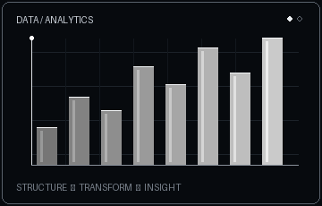
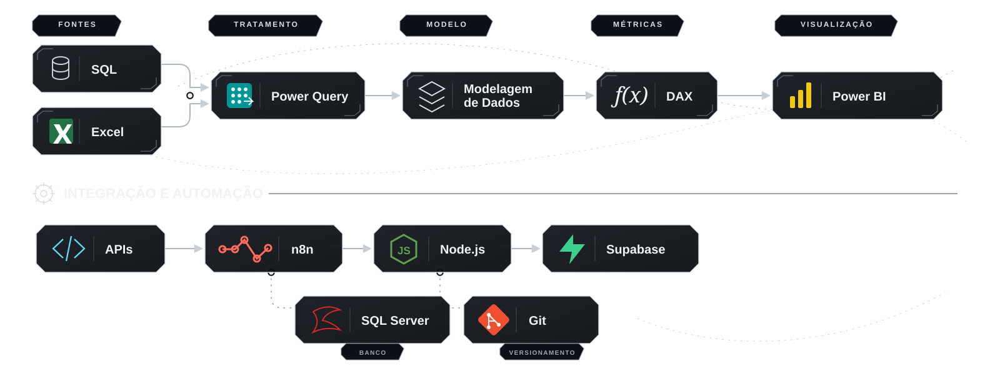
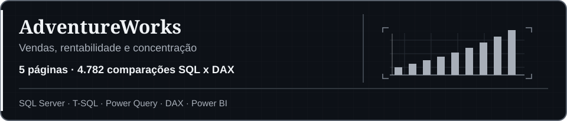
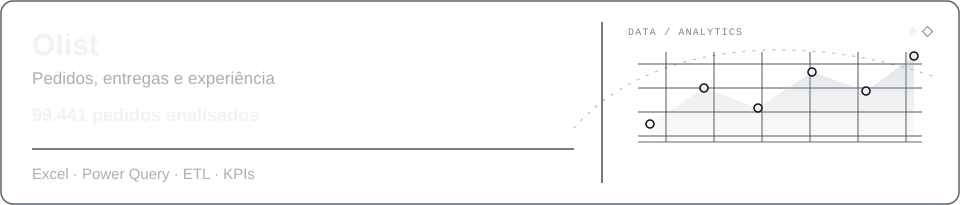
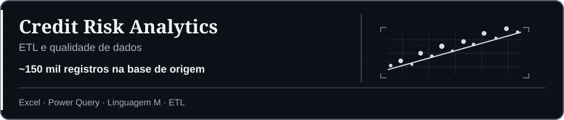
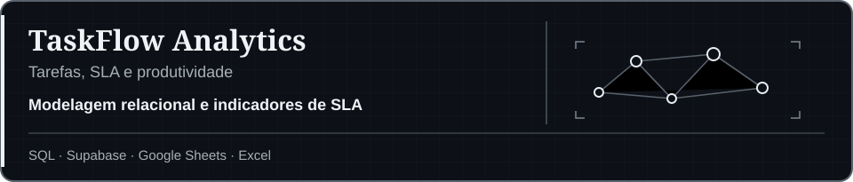

## Sobre mim

Estudante do quarto semestre do Bacharelado em Sistemas de Informação na UNEX e estagiária em Análise de Dados na Expertizze Sucesso do Cliente.

Atuo na preparação, transformação e análise de dados, desenvolvendo fluxos de atualização, dashboards e indicadores para apoiar demandas operacionais e de negócio. Em meus projetos, aplico SQL, Power BI, DAX, Power Query, Excel e modelagem de dados em análises comerciais, logísticas e operacionais.

Busco consolidar minha carreira como Analista de Dados, combinando capacidade analítica, organização técnica e comunicação clara dos resultados.

 

## Links

  
  

## Stack principal

## Experiência profissional

### Estagiária em Análise de Dados — Expertizze Sucesso do Cliente

Atuo na organização e análise de dados para pesquisas de satisfação, 
indicadores de desempenho e demandas de marketing.

- Estruturação e atualização dos dados da Pesquisa de Satisfação TSI.
- Tratamento, padronização e consolidação com Power Query.
- Dashboard para acompanhamento de desempenho.
- Análise de indicadores de satisfação e resultados.
- Análises de ações de brindes e marketing.
- Documentação e comunicação dos resultados analíticos.

`Fontes → Power Query → Tratamento → Indicadores → Dashboard`

 

## Projetos em destaque

Projeto ponta a ponta de Business Intelligence para análise de vendas, clientes, produtos, rentabilidade e territórios.

A solução utiliza SQL Server, views analíticas, Power Query, modelo dimensional, DAX e Power BI. O dashboard possui cinco páginas e apresenta receita, pedidos, ticket médio, margem bruta estimada, concentração, Pareto, crescimento e extremos estatísticos. A validação documenta **4.782 comparações entre SQL e DAX** no conjunto executado.

**Stack:** SQL Server · T-SQL · Power Query · Power BI · DAX · Modelagem Dimensional

  

Análise exploratória de **99.441 pedidos** do Brazilian E-Commerce Public Dataset, com foco em entregas, cumprimento de SLA, frete, distribuição geográfica e avaliações de clientes.

O projeto consolida diferentes fontes com Power Query e apresenta os resultados em dashboard e relatório executivo.

**Stack:** Excel · Power Query · ETL · KPIs · Análise Descritiva

  

Projeto de ETL e análise exploratória do dataset Give Me Some Credit, com **150 mil registros na origem** e 149.999 após o filtro de idade inválida.

O trabalho documenta limpeza, tipagem, tratamento de valores ausentes, criação de variáveis e segmentação descritiva. Os resultados não são apresentados como modelo preditivo ou ferramenta de decisão de crédito.

**Stack:** Excel · Power Query · Linguagem M · ETL · Qualidade de Dados

  

Projeto de análise operacional para acompanhar tarefas, prioridades, prazos, produtividade e cumprimento de SLA.

A solução combina planilhas, transferência por CSV, banco relacional no Supabase e consultas SQL para produzir indicadores por status, equipe, colaborador, prioridade e período.

**Stack:** SQL · PLpgSQL · Supabase · Google Sheets · Excel

  

## Projetos complementares

### [Distribuidora Alpha](https://github.com/karol123-CMD/projeto-sql-distribuidora-alpha)

Banco de dados relacional para uma distribuidora fictícia, com dez tabelas, doze relacionamentos e 38 consultas sobre faturamento, clientes, vendedores, produtos e categorias.  
**Stack:** SQL · SQLite · Modelagem Relacional

### [AI Commerce Readiness](https://github.com/karol123-CMD/ai-commerce-readiness-mvp)

Aplicação que integra interface web, servidor Node.js e workflow n8n para analisar a qualidade e a completude de anúncios de produtos.  
**Stack:** n8n · Node.js · JavaScript · APIs · Validação de Dados

## Formação, certificação e liderança

**Bacharelado em Sistemas de Informação — UNEX**  
Quarto semestre

**Google Data Analytics Professional Certificate — Google/Coursera**  
Concluído em outubro de 2026 · Programa composto por nove cursos

**Embaixadores Estudantis do Google 2026**  
Participação em atividades relacionadas à aplicação de inteligência artificial e ao desenvolvimento de competências de liderança e colaboração.

## Em desenvolvimento

- **Python para análise de dados:** fundamentos e laboratórios realizados durante o Google Data Analytics Professional Certificate.
- **Bancos de dados não relacionais:** modelagem aplicada a um projeto acadêmico privado.
- **Aplicação CRUD:** plataforma de avaliações em desenvolvimento acadêmico.
